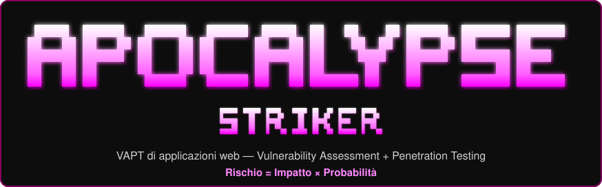
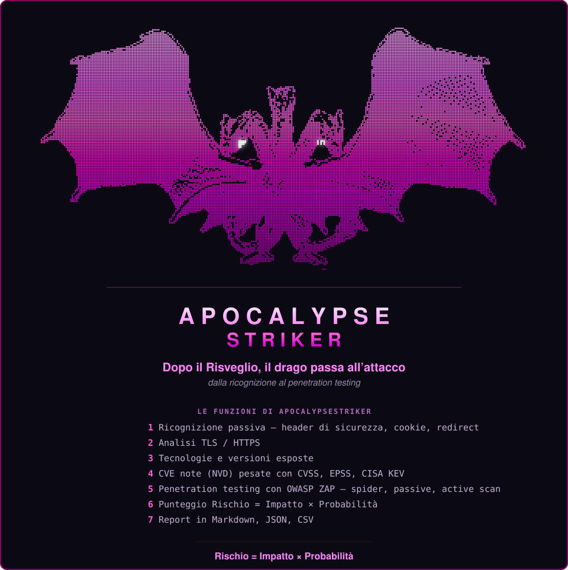

# ApocalypseStriker

<p align="center">
  
</p>

**VAPT di applicazioni web: Vulnerability Assessment + Penetration Testing.**

ApocalypseStriker è la terza versione della serie *Apocalypse*. Dove ApocalypseScan analizzava una *macchina Linux*, Striker punta un'**applicazione web** (un URL) e ne produce un report, ordinato secondo lo stesso schema:

> **Rischio = Impatto × Probabilità**

Il VAPT si compone di due fasi, due livelli di invasività:

| Fase | Tipo | Cosa fa | Stato |
|---|---|---|---|
| **Vulnerability Assessment** | passiva (sola lettura) | legge header di sicurezza, cookie, TLS e tecnologie come un browser, e cerca le CVE note delle versioni | **attiva** |
| **Penetration Testing** (OWASP ZAP) | attiva (sollecita il bersaglio) | spider e passive scan osservano; l'*active scan* invia richieste di prova | modulo pronto, fase a sé (vedi [§9](#9-sviluppi-futuri)) |

Ogni finding riceve un impatto (1-5) e una probabilità (1-5); la probabilità delle CVE è pesata con i dati **CVSS**, **EPSS** e **CISA KEV**. Il report li riunisce in un'unica tabella con una matrice di rischio 5×5.

> ⚠️ **Uso autorizzato.** Analizza solo applicazioni di tua proprietà o per cui hai un'autorizzazione esplicita e **scritta**: analizzare un sito altrui senza permesso è un reato. All'avvio il programma mostra l'URL, l'ambiente e la data e chiede di confermarlo; l'active scan (intrusivo) è protetto da un **secondo** consenso dedicato.

---

## Panoramica del progetto

ApocalypseStriker contatta l'applicazione indicata come farebbe un browser, raccoglie informazioni **senza alterare il bersaglio** (ricognizione passiva), valuta il rischio di ogni finding secondo lo schema impatto × probabilità e genera un report in Markdown (e, a richiesta, JSON e CSV).

La ricognizione passiva rileva:

- **header di sicurezza** — HSTS, Content-Security-Policy, X-Content-Type-Options, X-Frame-Options, Referrer-Policy: presenza e valore;
- **cookie** — attributi `Secure`, `HttpOnly`, `SameSite` (il valore dei cookie non viene mai salvato nel report);
- **TLS / HTTPS** — versioni del protocollo accettate, redirect `http→https`, validità del certificato;
- **tecnologie** — server e framework dichiarati (es. nginx, PHP) e, dove possibile, la versione;
- **CVE note** — per prodotto e versione, cercate su NVD e pesate con KEV/EPSS.

Il penetration testing attivo si appoggia a **OWASP ZAP** (modulo [`web/zap_scan.py`](apocalypsescan_app/web/zap_scan.py)): spider e passive scan non attaccano, l'*active scan* invia payload ed è l'unica parte che sollecita il bersaglio. Tutta la comunicazione, sia nella ricognizione sia verso ZAP, usa solo la **libreria standard** di Python.

### Il drago, dopo il Risveglio, passa all'attacco

Nella prima versione il drago rosso a sette teste, dopo il *Risveglio Primordiale*, divora il nucleo blu e diventa una sola mente viola. In ApocalypseStriker il drago è già risvegliato — qui **fucsia** — e passa dall'osservare la macchina al puntare l'applicazione: dall'assessment al penetration testing.

<p align="center">
  
</p>

---

## Indice

0. [Panoramica del progetto](#panoramica-del-progetto)
1. [Requisiti](#1-requisiti)
2. [Installazione](#2-installazione)
3. [Bersagli di prova](#3-bersagli-di-prova)
4. [Utilizzo](#4-utilizzo)
5. [Il report e il modello di rischio](#5-il-report-e-il-modello-di-rischio)
6. [Opzioni](#6-opzioni)
7. [Struttura del repository](#7-struttura-del-repository)
8. [Problemi frequenti](#8-problemi-frequenti)
9. [Sviluppi futuri](#9-sviluppi-futuri)
10. [Riferimenti](#10-riferimenti)

---

## 1. Requisiti

| Requisito | Note |
|---|---|
| Python **3.9+** con `venv` | su Debian/Ubuntu/WSL: pacchetto `python3-venv` |
| connessione di rete verso l'applicazione da analizzare | il Vulnerability Assessment contatta l'URL in sola lettura |
| (facoltativo) **Docker** | solo per il penetration testing attivo con OWASP ZAP (vedi [§9](#9-sviluppi-futuri)) |

Il Vulnerability Assessment usa **solo la libreria standard** di Python: non ci sono dipendenze esterne da installare. Funziona su Linux, WSL e macOS; su Windows il menù e la scansione passiva funzionano in un terminale UTF-8 (Windows Terminal).

---

## 2. Installazione

### 2.1. Con `install.sh` (Linux / WSL / macOS)

```bash
git clone https://github.com/<utente>/ApocalypseStriker.git
cd ApocalypseStriker

./install.sh        # crea .venv, aggiorna pip e installa il comando "apocalypse"
source .venv/bin/activate
```

`install.sh` prepara **solo l'ambiente Python**: crea il virtualenv `.venv`, aggiorna `pip` e installa il pacchetto in modalità modificabile (`pip install -e .`), che registra nel venv il comando `apocalypse`. È idempotente: se `.venv` esiste già lo riusa.

Da quel momento, con il venv attivo:

```bash
apocalypse attack                      # apre il menù interattivo
apocalypse attack https://badssl.com   # scansione diretta su un URL
```

> Gli strumenti esterni **non** sono gestiti da `install.sh`. In particolare OWASP ZAP (usato dal penetration testing attivo) va installato a parte, di norma in Docker.

### 2.2. A mano (anche su Windows)

```bash
python3 -m venv .venv
source .venv/bin/activate          # Windows: .venv\Scripts\activate
pip install -e .
```

### 2.3. Se `apocalypse` non viene trovato (`command not found`)

Il comando vive nel venv (`/.venv/bin/apocalypse`, su Windows `.venv\Scripts\apocalypse.exe`): viene trovato **solo a venv attivo**.

1. controlla che il prompt mostri `(.venv)`; se no, `source .venv/bin/activate`;
2. verifica dove punta: `which apocalypse` (Linux) / `Get-Command apocalypse` (PowerShell) — deve stare dentro `.venv`;
3. se manca, rilancia `pip install -e .`; eventualmente `hash -r` per aggiornare la cache della shell.

In alternativa, senza attivare il venv, funziona sempre `python -m apocalypsescan_app.cli attack`.

> **WSL e Windows non condividono lo stesso `.venv`** (uno ha `bin/`, l'altro `Scripts/`). Se il progetto è su un disco Windows e vuoi usarlo da WSL, monta il disco (`sudo mount -t drvfs D: /mnt/d`), rimuovi l'eventuale `.venv` di Windows (`rm -rf .venv`) e rilancia `./install.sh`.

---

## 3. Bersagli di prova

Per esercitarti servono applicazioni **pensate per essere testate**. Non usare mai Striker su siti altrui.

| Bersaglio | URL | Note |
|---|---|---|
| Acunetix *vulnweb* | `http://testphp.vulnweb.com` | volutamente vulnerabile |
| *Altoro Mutual* (demo IBM/HCL) | `https://demo.testfire.net` | finta banca di prova |
| *badssl* | `https://badssl.com` | tanti casi di TLS/HTTPS buoni e cattivi |
| **OWASP Juice Shop** (locale) | `http://localhost:3000` | `docker run --rm -p 3000:3000 bkimminich/juice-shop` |

Il bersaglio locale (Juice Shop) è anche il più adatto al penetration testing attivo, perché resta sulla tua macchina.

---

## 4. Utilizzo

### 4.1. Il modo più semplice: `apocalypse attack`

```bash
apocalypse attack
```

apre un menù testuale a colori (fucsia) con il banner e le voci:

| Voce | Contenuto |
|---|---|
| Come funziona | cos'è un VAPT, le due fasi, il punteggio impatto × probabilità |
| Prima di iniziare | autorizzazione e bersagli di prova |
| Vulnerability Assessment | la scansione passiva: cosa controlla |
| Penetration Testing | la scansione attiva (ZAP) e il doppio consenso |
| Opzioni e report | i flag disponibili, i formati e dove finiscono i report |
| **Esegui una scansione** | scansione guidata su un URL (vedi sotto) |

Si sceglie una voce digitandone il numero e premendo `Invio`; `0` (o `Ctrl+C`) esce.

La **scansione guidata** chiede, in ordine: l'**URL**, l'**ambiente** (`sviluppo`, `test`, `staging`, `produzione`), il tipo di analisi (solo VA passivo o anche il PT attivo), se cercare le **CVE su NVD** e in quali **formati** salvare il report. Costruisce il comando equivalente, lo mostra e, se vuoi, lo avvia. Prima di partire viene sempre chiesta la conferma di autorizzazione.

I colori seguono la palette fucsia del drago e si disattivano da soli quando l'output non è un terminale o è impostata la variabile `NO_COLOR`. Senza il comando `apocalypse`, il menù si apre con `python -m apocalypsescan_app.menu_web`.

### 4.2. Scansione diretta: `apocalypse attack <url>`

```bash
apocalypse attack https://badssl.com
```

Chiede l'ambiente (se non indicato con `--env`) e la conferma di autorizzazione, poi esegue il Vulnerability Assessment e scrive il report.

```bash
# ambiente e formati sulla riga di comando
apocalypse attack https://esempio.it --env produzione --format md,json,csv

# scansione non interattiva (serve --env), senza interrogare NVD
apocalypse attack https://esempio.it --yes --env test --no-nvd
```

### 4.3. Output a terminale

All'avvio compare l'animazione del **drago fucsia** in caratteri Braille; si disattiva con `--no-banner` ed è omessa se l'output non è un terminale o è impostata `NO_COLOR`. Durante l'esecuzione una barra di avanzamento mostra le fasi (ricognizione, CVE, report) con il tempo trascorso; al termine viene stampato il numero di finding valutati e il percorso del report.

---

## 5. Il report e il modello di rischio

### 5.1. Contenuto del report

Il report (`reports/md/`) contiene, nell'ordine:

1. **Intestazione**: URL analizzato, data, ambiente e dati dell'autorizzazione;
2. **Ricognizione**: stato HTTP, eventuali redirect, esito TLS e tecnologie riconosciute (con le CVE note);
3. **Tabella dei rischi**: conteggio per livello, **matrice 5×5** ed elenco dei finding ordinati per rischio, ognuno con categoria **OWASP**, URL ed evidenza (richiesta/risposta);
4. **Fuori portata**: cosa il Vulnerability Assessment passivo non può confermare e che richiede il penetration testing attivo.

I formati disponibili sono **Markdown** (leggibile), **JSON** (il modello completo) e **CSV** (i finding in tabella); finiscono nelle cartelle `reports/md/`, `reports/json/`, `reports/csv/`. Il report HTML per il web è in arrivo (vedi [§9](#9-sviluppi-futuri)).

### 5.2. Modello: Rischio = Impatto × Probabilità

| Valore | Impatto (danno se sfruttato) | Probabilità (verosimiglianza) |
|---:|---|---|
| 1 | Trascurabile | Rara |
| 2 | Basso | Improbabile |
| 3 | Moderato | Possibile |
| 4 | Alto | Probabile |
| 5 | Critico | Quasi certa |

| Punteggio | Livello |
|---:|---|
| 16 – 25 | **Critico** |
| 10 – 15 | **Alto** |
| 5 – 9 | **Medio** |
| 1 – 4 | **Basso** |

Per le CVE la probabilità è pesata con il punteggio **CVSS**, l'**EPSS** (quanto è probabile lo sfruttamento) e il catalogo **CISA KEV** (se la vulnerabilità è già sfruttata in concreto). Tutti i valori sono in [`apocalypsescan_app/config.py`](apocalypsescan_app/config.py).

> I livelli sono una stima euristica per **prioritizzare** l'analisi, non una valutazione definitiva: i finding più rilevanti vanno sempre verificati manualmente (ad esempio sul [NVD](https://nvd.nist.gov/)) e, per confermarli, con il penetration testing attivo.

---

## 6. Opzioni

Opzioni di `apocalypse attack <url>`:

| Opzione | Descrizione | Default |
|---|---|---|
| `--env AMBIENTE` | ambiente dell'applicazione (`sviluppo`, `test`, `staging`, `produzione`), scritto nel report | chiesto se manca |
| `--format FORMATI` | formati del report separati da virgola: `md`, `json`, `csv` | `md` |
| `--no-nvd` | non cercare le CVE su NVD (prodotto e versione non escono dalla macchina) | NVD interrogato |
| `--output NOME` | nome del report | `web_<timestamp>` |
| `--yes` | salta la conferma di autorizzazione (richiede `--env`) | conferma chiesta |
| `--no-banner` | non mostra l'animazione del drago all'avvio | animazione mostrata |

`apocalypse attack --help` mostra l'elenco completo.

---

## 7. Struttura del repository

```text
ApocalypseStriker/
├── pyproject.toml              # pacchetto e comando "apocalypse" ([project.scripts])
├── install.sh                  # crea il venv e installa il comando (Linux/WSL/macOS)
├── apocalypsescan_app/
│   ├── cli.py                  # punto di ingresso: "apocalypse attack" (menù o <url>)
│   ├── menu_web.py             # menù interattivo e scansione guidata
│   ├── menu_stile.py           # stile del menù (banner, cornici, colori fucsia)
│   ├── banner.py               # animazione del drago (forma fucsia)
│   ├── arte_braille.py         # il drago in caratteri Braille
│   ├── config.py               # modello di rischio e parametri del VAPT web
│   ├── risk.py                 # calcolo impatto × probabilità
│   ├── report_model.py         # modello comune dei finding
│   ├── threat_intel.py         # dati CISA KEV ed EPSS
│   ├── progress.py             # barra di avanzamento a colori
│   ├── web/
│   │   ├── recon.py            # ricognizione passiva (HTTP, TLS, tecnologie) — solo stdlib
│   │   ├── web_risk.py         # valutazione dei finding web (categoria OWASP)
│   │   ├── cve_nvd.py          # ricerca delle CVE note su NVD
│   │   ├── web_report.py       # pipeline del Vulnerability Assessment e scrittura report
│   │   └── zap_scan.py         # wrapper OWASP ZAP (penetration testing attivo)
│   └── renderers/
│       ├── markdown_web.py     # report Markdown del VAPT web
│       ├── json_out.py         # report JSON (il modello completo)
│       └── csv_out.py          # report CSV (i finding in tabella)
├── assets/
│   ├── apocalypse-striker-banner.svg   # logo APOCALYPSE STRIKER (in cima al README)
│   └── apocalypse-striker-dragon.svg   # il drago fucsia e le funzioni del VAPT web
└── reports/                    # report generati, una sottocartella per formato
```

---

## 8. Problemi frequenti

| Problema | Causa e soluzione |
|---|---|
| `apocalypse: command not found` | attiva il venv (`source .venv/bin/activate`); se manca, rilancia `pip install -e .`. Vedi [§2.3](#23-se-apocalypse-non-viene-trovato-command-not-found) |
| Il banner mostra il drago piccolo / caratteri rotti | il terminale non è UTF-8 o è troppo stretto: usa un terminale UTF-8 (Windows Terminal), allarga la finestra o imposta `LANG=C.UTF-8` |
| `con --yes l'ambiente va indicato con --env` | la modalità non interattiva ha bisogno dell'ambiente: aggiungi `--env test` |
| La scansione non trova l'host / va in timeout | URL errato, oppure la rete in uscita è filtrata: verifica di raggiungere l'URL da un browser. Alcuni bersagli di prova pubblici sono a volte irraggiungibili |
| `Il report HTML non è ancora disponibile per il web` | per il web i formati sono `md`, `json`, `csv`; l'HTML è in arrivo |
| L'active scan (ZAP) non parte dalla scansione guidata | è una fase a sé e richiede un daemon ZAP in esecuzione: vedi [§9](#9-sviluppi-futuri) |
| Su WSL il comando non c'è ma su Windows sì (o viceversa) | i due sistemi non condividono il `.venv`: vedi la nota in [§2.3](#23-se-apocalypse-non-viene-trovato-command-not-found) |

---

## 9. Sviluppi futuri

- **Penetration testing attivo nel flusso**: collegare il modulo [`web/zap_scan.py`](apocalypsescan_app/web/zap_scan.py) (spider, passive e *active scan* di OWASP ZAP) alla scansione guidata, con il **secondo consenso** dedicato e un daemon ZAP in Docker. Il passivo è già validato; l'attivo è scritto ma ancora fuori dal flusso.
- **Report HTML per il web**: un renderer `html_web` con lo stile della testata, da aprire nel browser (oggi l'HTML esiste solo per i report host).
- **Più controlli passivi**: `Set-Cookie` su più risposte, header di sicurezza aggiuntivi, catena dei certificati TLS.
- **Deduplica recon ↔ ZAP**: unire i finding che entrambe le fasi rilevano (ad esempio gli header) senza doppioni.
- **Confronto tra report** per seguire l'andamento del rischio nel tempo dopo le correzioni.

---

## 10. Riferimenti

**Metodologia**

- OWASP Web Security Testing Guide: <https://owasp.org/www-project-web-security-testing-guide/>
- OWASP Top Ten: <https://owasp.org/www-project-top-ten/>
- OWASP Risk Rating Methodology: <https://owasp.org/www-community/OWASP_Risk_Rating_Methodology>
- NIST SP 800-115, *Technical Guide to Information Security Testing and Assessment*: <https://csrc.nist.gov/pubs/sp/800/115/final>

**Strumenti e dati**

- OWASP ZAP: <https://www.zaproxy.org/>
- NVD – National Vulnerability Database: <https://nvd.nist.gov/>
- CVSS (FIRST): <https://www.first.org/cvss/>
- EPSS – Exploit Prediction Scoring System: <https://www.first.org/epss/>
- CISA Known Exploited Vulnerabilities: <https://www.cisa.gov/known-exploited-vulnerabilities-catalog>

**Header di sicurezza e TLS**

- MDN HTTP headers: <https://developer.mozilla.org/en-US/docs/Web/HTTP/Headers>
- Mozilla Web Security guidelines: <https://infosec.mozilla.org/guidelines/web_security>
