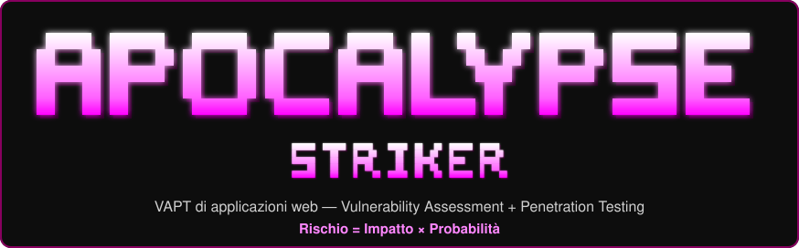
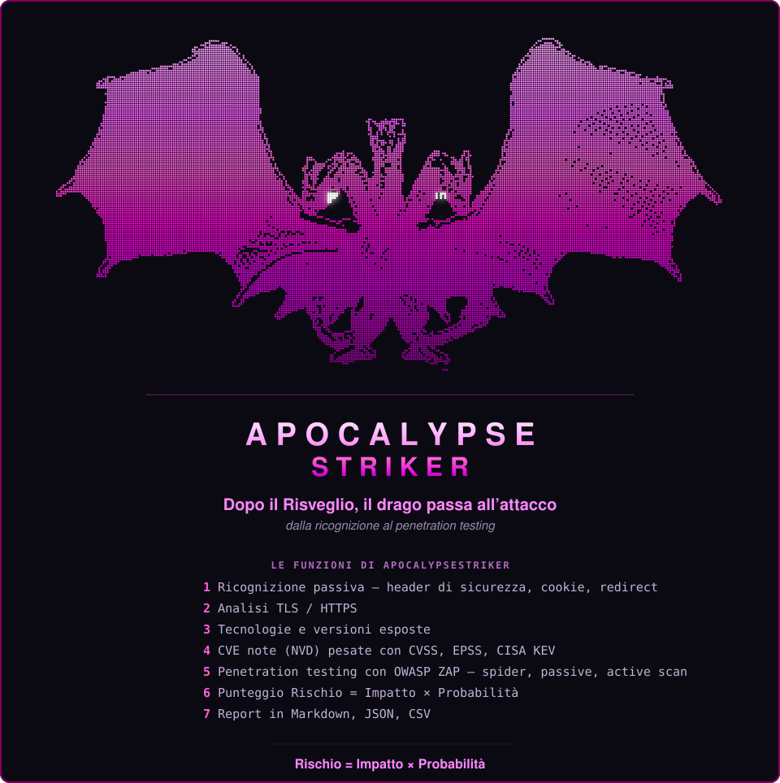

# ApocalypseStriker

<p align="center">
  
</p>

**VAPT di applicazioni web: Vulnerability Assessment + Penetration Testing.**

ApocalypseStriker è la terza versione della serie *Apocalypse*. Dove ApocalypseScan analizzava una *macchina Linux*, Striker punta un'**applicazione web** (un URL) e ne produce un report, ordinato secondo lo stesso schema:

> **Rischio = Impatto × Probabilità**

Il VAPT si compone di due fasi, due livelli di invasività:

| Fase | Tipo | Cosa fa | Stato |
|---|---|---|---|
| **Vulnerability Assessment** | passiva (sola lettura) | legge header di sicurezza, cookie, TLS e tecnologie come un browser, e cerca le CVE note delle versioni | **attiva** |
| **Penetration Testing** (motore nativo) | attiva (sollecita il bersaglio) | scopre i punti di input (parametri e form) e invia payload per confermare SQLi, XSS, command injection, SSTI, path traversal, open redirect, file esposti | **attiva** — opzione `--pentest`, sola stdlib (vedi [§4.4](#44-penetration-testing-attivo---pentest)) |
| **Penetration Testing** (OWASP ZAP) | attiva (sollecita il bersaglio) | spider e passive scan osservano; l'*active scan* invia richieste di prova | alternativa avanzata, richiede un daemon ZAP (vedi [§9](#9-sviluppi-futuri)) |

Ogni finding riceve un impatto (1-5) e una probabilità (1-5); la probabilità delle CVE è pesata con i dati **CVSS**, **EPSS** e **CISA KEV**. Il report li riunisce in un'unica tabella con una matrice di rischio 5×5.

> ⚠️ **Uso autorizzato.** Analizza solo applicazioni di tua proprietà o per cui hai un'autorizzazione esplicita e **scritta**: analizzare un sito altrui senza permesso è un reato. All'avvio il programma mostra l'URL, l'ambiente e la data e chiede di confermarlo; l'active scan (intrusivo) è protetto da un **secondo** consenso dedicato.

---

## Panoramica del progetto

ApocalypseStriker contatta l'applicazione indicata come farebbe un browser, raccoglie informazioni **senza alterare il bersaglio** (ricognizione passiva), valuta il rischio di ogni finding secondo lo schema impatto × probabilità e genera un report in Markdown (e, a richiesta, JSON e CSV).

La ricognizione passiva rileva:

- **header di sicurezza** — HSTS, Content-Security-Policy, X-Content-Type-Options, X-Frame-Options, Referrer-Policy: presenza e valore;
- **cookie** — attributi `Secure`, `HttpOnly`, `SameSite` (il valore dei cookie non viene mai salvato nel report);
- **TLS / HTTPS** — versioni del protocollo accettate, redirect `http→https`, validità del certificato;
- **tecnologie** — server e framework dichiarati (es. nginx, PHP) e, dove possibile, la versione;
- **CVE note** — per prodotto e versione, cercate su NVD e pesate con KEV/EPSS.

Il penetration testing attivo è un **motore nativo** ([`web/pentest.py`](apocalypsescan_app/web/pentest.py)), scritto in sola **libreria standard** (nessuna dipendenza, gira anche su un Raspberry). Con l'opzione `--pentest` scopre i punti di input dell'applicazione (parametri dell'URL e campi dei form, seguendo i link interni con un crawler leggero) e vi invia **payload di prova** per confermare — con un confronto rispetto alla risposta di base — SQL injection (errore, boolean, time), XSS riflesso, command injection, SSTI, path traversal/LFI, open redirect e file sensibili esposti. È intrusivo e perciò protetto da un **secondo consenso** dedicato; i payload sono di sola lettura e non distruttivi, con un tetto di richieste. In alternativa, per chi ha già un daemon **OWASP ZAP**, resta il wrapper [`web/zap_scan.py`](apocalypsescan_app/web/zap_scan.py) (spider, passive e active scan).

### Il drago, dopo il Risveglio, passa all'attacco

Nella prima versione il drago rosso a sette teste, dopo il *Risveglio Primordiale*, divora il nucleo blu e diventa una sola mente viola. In ApocalypseStriker il drago è già risvegliato — qui **fucsia** — e passa dall'osservare la macchina al puntare l'applicazione: dall'assessment al penetration testing.

<p align="center">
  
</p>

---

## Indice

0. [Panoramica del progetto](#panoramica-del-progetto)
1. [Requisiti](#1-requisiti)
2. [Installazione](#2-installazione)
3. [Bersagli di prova](#3-bersagli-di-prova)
4. [Utilizzo](#4-utilizzo)
5. [Il report e il modello di rischio](#5-il-report-e-il-modello-di-rischio)
6. [Opzioni](#6-opzioni)
7. [Struttura del repository](#7-struttura-del-repository)
8. [Problemi frequenti](#8-problemi-frequenti)
9. [Sviluppi futuri](#9-sviluppi-futuri)
10. [Riferimenti](#10-riferimenti)

---

## 1. Requisiti

| Requisito | Note |
|---|---|
| Python **3.9+** con `venv` | su Debian/Ubuntu/WSL: pacchetto `python3-venv` |
| connessione di rete verso l'applicazione da analizzare | il Vulnerability Assessment contatta l'URL in sola lettura |
| (facoltativo) **Docker** | solo per il penetration testing attivo con OWASP ZAP (vedi [§9](#9-sviluppi-futuri)) |

Il Vulnerability Assessment usa **solo la libreria standard** di Python: non ci sono dipendenze esterne da installare. Funziona su Linux, WSL e macOS; su Windows il menù e la scansione passiva funzionano in un terminale UTF-8 (Windows Terminal).

---

## 2. Installazione

### 2.1. Con `install.sh` (Linux / WSL / macOS)

```bash
git clone https://github.com/<utente>/ApocalypseStriker.git
cd ApocalypseStriker

./install.sh        # crea .venv, aggiorna pip e installa il comando "apocalypse"
source .venv/bin/activate
```

`install.sh` prepara **solo l'ambiente Python**: crea il virtualenv `.venv`, aggiorna `pip` e installa il pacchetto in modalità modificabile (`pip install -e .`), che registra nel venv il comando `apocalypse`. È idempotente: se `.venv` esiste già lo riusa.

Da quel momento, con il venv attivo:

```bash
apocalypse attack                      # apre il menù interattivo
apocalypse attack https://badssl.com   # scansione diretta su un URL
```

> Gli strumenti esterni **non** sono gestiti da `install.sh`. In particolare OWASP ZAP (usato dal penetration testing attivo) va installato a parte, di norma in Docker.

### 2.2. A mano (anche su Windows)

```bash
python3 -m venv .venv
source .venv/bin/activate          # Windows: .venv\Scripts\activate
pip install -e .
```

### 2.3. Se `apocalypse` non viene trovato (`command not found`)

Il comando vive nel venv (`/.venv/bin/apocalypse`, su Windows `.venv\Scripts\apocalypse.exe`): viene trovato **solo a venv attivo**.

1. controlla che il prompt mostri `(.venv)`; se no, `source .venv/bin/activate`;
2. verifica dove punta: `which apocalypse` (Linux) / `Get-Command apocalypse` (PowerShell) — deve stare dentro `.venv`;
3. se manca, rilancia `pip install -e .`; eventualmente `hash -r` per aggiornare la cache della shell.

In alternativa, senza attivare il venv, funziona sempre `python -m apocalypsescan_app.cli attack`.

> **WSL e Windows non condividono lo stesso `.venv`** (uno ha `bin/`, l'altro `Scripts/`). Se il progetto è su un disco Windows e vuoi usarlo da WSL, monta il disco (`sudo mount -t drvfs D: /mnt/d`), rimuovi l'eventuale `.venv` di Windows (`rm -rf .venv`) e rilancia `./install.sh`.

---

## 3. Bersagli di prova

Per esercitarti servono applicazioni **pensate per essere testate**. Non usare mai Striker su siti altrui.

| Bersaglio | URL | Note |
|---|---|---|
| Acunetix *vulnweb* | `http://testphp.vulnweb.com` | volutamente vulnerabile |
| *Altoro Mutual* (demo IBM/HCL) | `https://demo.testfire.net` | finta banca di prova |
| *badssl* | `https://badssl.com` | tanti casi di TLS/HTTPS buoni e cattivi |
| **OWASP Juice Shop** (locale) | `http://localhost:3000` | `docker run --rm -p 3000:3000 bkimminich/juice-shop` |

Il bersaglio locale (Juice Shop) è anche il più adatto al penetration testing attivo, perché resta sulla tua macchina.

---

## 4. Utilizzo

### 4.1. Il modo più semplice: `apocalypse attack`

```bash
apocalypse attack
```

apre un menù testuale a colori (fucsia) con il banner e le voci:

| Voce | Contenuto |
|---|---|
| Come funziona | cos'è un VAPT, le due fasi, il punteggio impatto × probabilità |
| Prima di iniziare | autorizzazione e bersagli di prova |
| Vulnerability Assessment | la scansione passiva: cosa controlla |
| Penetration Testing | la scansione attiva e il doppio consenso |
| Opzioni e report | i flag disponibili, i formati, il nome del report e la spiegazione guidata |
| **Esegui una scansione** | scansione guidata su un URL, con spiegazione dei risultati (vedi sotto) |
| **Interpreta report** | sceglie un report salvato e ne mostra la spiegazione guidata (vedi sotto) |

Si sceglie una voce digitandone il numero e premendo `Invio`; `0` (o `Ctrl+C`) esce.

La **scansione guidata** chiede, in ordine: l'**URL**, l'**ambiente** (`sviluppo`, `test`, `staging`, `produzione`), il tipo di analisi (solo VA passivo o anche il PT attivo), se cercare le **CVE su NVD**, in quali **formati** salvare il report (Markdown, HTML o entrambi, eventualmente con il CSV; proposto Markdown + HTML) e il **nome del report** (proposto `web_<data-ora>`; solo lettere, cifre, `_` e `-`, senza cartelle né estensione: diventa `--output NOME`) e se vuoi anche la **spiegazione guidata** dei risultati (`--interpreta`, proposta di default). Costruisce il comando equivalente, lo mostra e, se vuoi, lo avvia. Prima di partire viene sempre chiesta la conferma di autorizzazione. Il penetration testing attivo si sceglie qui, al passo *Tipo di analisi*: non serve lanciarlo a parte.

La scansione guidata salva **sempre anche il JSON** (`reports/json/NOME.json`), qualunque formato tu scelga: è il modello completo della scansione, quello che la voce **Interpreta report** rilegge.

La voce **Interpreta report** elenca i report in `reports/json/` (dal più recente, con URL, data e se c'era il pentest); scelto un report, ne stampa a terminale la spiegazione guidata (verdetto, priorità e, per ogni finding, cosa significa, come viene attaccato e cosa fare) e la salva, o la aggiorna, in `reports/md/<nome>_interpretazione.md`. Funziona anche per le scansioni fatte senza `--interpreta`.

I colori seguono la palette fucsia del drago e si disattivano da soli quando l'output non è un terminale o è impostata la variabile `NO_COLOR`. Senza il comando `apocalypse`, il menù si apre con `python -m apocalypsescan_app.menu_web`.

### 4.2. Scansione diretta: `apocalypse attack <url>`

```bash
apocalypse attack https://badssl.com
```

Chiede l'ambiente (se non indicato con `--env`) e la conferma di autorizzazione, poi esegue il Vulnerability Assessment e scrive il report.

```bash
# ambiente e formati sulla riga di comando
apocalypse attack https://esempio.it --env produzione --format md,html,json,csv

# scansione non interattiva (serve --env), senza interrogare NVD
apocalypse attack https://esempio.it --yes --env test --no-nvd
```

### 4.3. Output a terminale

All'avvio compare l'animazione del **drago fucsia** in caratteri Braille; si disattiva con `--no-banner` ed è omessa se l'output non è un terminale o è impostata `NO_COLOR`. Durante l'esecuzione una barra di avanzamento mostra le fasi (ricognizione, CVE, eventuale crawl e pentest, report) con il tempo trascorso; al termine viene stampato il numero di finding valutati e il percorso del report.

### 4.4. Penetration testing attivo: `--pentest`

Aggiungendo `--pentest` (o scegliendo *Anche Penetration Testing* nella scansione guidata) dopo il Vulnerability Assessment parte la **fase attiva nativa**: un crawler leggero scopre gli endpoint parametrici e i form dello stesso host, poi ogni punto di input viene provato con payload mirati e il risultato è confrontato con una risposta di base.

```bash
# VA passivo + penetration testing attivo (chiede DUE consensi)
apocalypse attack http://localhost:3000 --pentest

# non interattivo: salta autorizzazione e secondo consenso (solo su bersagli tuoi!)
apocalypse attack http://localhost:3000 --env test --yes --pentest --format md,json

# senza crawler: testa solo l'URL dato e i suoi form
apocalypse attack 'http://localhost:3000/cerca?q=1' --pentest --no-crawl
```

**Cosa conferma** (con tecnica differenziale, non a tentativi ciechi):

| Classe | OWASP | Come viene confermata |
|---|---|---|
| SQL injection | A03 | errore SQL assente nella base; condizione vera≈base / falsa diversa; ritardo time-based con controllo |
| Cross-Site Scripting (riflesso) | A03 | marcatore con `<` `>` `"` `'` riflesso **senza** codifica HTML |
| Command injection | A03 | `sleep` via concatenatori di shell ritarda la risposta (controllo veloce) |
| SSTI | A03 | un'espressione di template (`{{a*b}}`, `${a*b}`...) viene **calcolata** |
| Path traversal / LFI | A01 | `../` legge un file di sistema noto (`/etc/passwd`, `win.ini`) |
| Open redirect | A01 | il parametro reindirizza verso un host esterno di prova |
| File sensibili esposti | A05 | `.env`, `.git`, backup, elenco directory scaricabili (con firma di contenuto) |
| SSRF | A10 | candidato segnalato per verifica manuale (serve un callback controllato) |

**Sicurezza della fase attiva.** È intrusiva: perciò un **secondo consenso** dedicato (`--yes-pentest` per saltarlo in automazione) oltre all'autorizzazione iniziale. I payload sono **di sola lettura e non distruttivi** (niente `DROP`/`DELETE`/upload); un tetto di richieste (`PT_MAX_REQUESTS`), un tetto ai punti di input (`PT_MAX_POINTS`) e un tetto alle sonde lente (`PT_MAX_TIME_PROBES`) evitano di sovraccaricare il bersaglio. Tutti i parametri sono in [`config.py`](apocalypsescan_app/config.py), blocco *Penetration testing ATTIVO*. I finding attivi entrano nella **stessa** tabella di rischio dei passivi, con categoria OWASP, URL, parametro ed evidenza (richiesta → risposta); nel report la sezione *Portata dell'analisi* segnala quali categorie sono state provate con payload.

---

## 5. Il report e il modello di rischio

### 5.1. Contenuto del report

Il report (`reports/md/`) contiene, nell'ordine:

1. **Intestazione**: URL analizzato, data, ambiente e dati dell'autorizzazione;
2. **Ricognizione**: stato HTTP, eventuali redirect, esito TLS e tecnologie riconosciute (con le CVE note);
3. **Tabella dei rischi**: conteggio per livello, **matrice 5×5** ed elenco dei finding ordinati per rischio, ognuno con categoria **OWASP**, URL ed evidenza (richiesta/risposta);
4. **Fuori portata**: cosa il Vulnerability Assessment passivo non può confermare e che richiede il penetration testing attivo.

I formati disponibili sono **Markdown** (leggibile), **HTML** (da aprire nel browser), **JSON** (il modello completo) e **CSV** (i finding in tabella); finiscono nelle cartelle `reports/md/`, `reports/html/`, `reports/json/`, `reports/csv/`.

Il report **HTML** ha lo stesso contenuto del Markdown, impaginato per il browser (tema chiaro/scuro automatico). È un file unico e autonomo: CSS interno, nessuno script, nessuna risorsa esterna, quindi si apre anche offline; tutti i valori letti dal bersaglio (header, URL, payload nelle evidenze) sono resi come testo. Con `--interpreta` contiene anche la sezione **Spiegazione guidata** (vedi [§5.3](#53-spiegazione-guidata---interpreta)).

### 5.3. Spiegazione guidata: `--interpreta`

Con `--interpreta` (o rispondendo sì nella scansione guidata) dopo i report viene generata anche una **lettura in linguaggio semplice** dei risultati, dal modello già in memoria. Viene salvata con lo stesso nome del report, `reports/md/<nome>_interpretazione.md`, inclusa nel report HTML (se richiesto) e la parte essenziale viene stampata a terminale. Per una scansione già salvata si usa la voce **Interpreta report** del menù.

```bash
apocalypse attack https://esempio.it --pentest --output audit_cliente --interpreta
# -> reports/md/audit_cliente.md  e  reports/md/audit_cliente_interpretazione.md
```

La lettura contiene il **verdetto** complessivo, i conteggi per livello, i **punti chiave** (passivo o anche attivo, categorie OWASP coinvolte, CVE nel catalogo KEV), le **priorità** (i finding a rischio più alto) e, per ogni finding, una scheda in tre voci:

- **Cosa significa**: la causa tecnica, in una o due frasi;
- **Come viene attaccata**: l'attacco concreto e cosa ottiene l'attaccante;
- **Cosa fare**: la correzione, concisa e azionabile;

più il *perché* del livello (impatto × probabilità, con la scala del modello di rischio) e i **limiti**: cosa non è stato controllato (pentest non eseguito o troncato, NVD disattivato, categorie OWASP non testate).

Le schede coprono SQL injection, XSS, command injection, SSTI, path traversal/LFI, open redirect, SSRF (come candidato da verificare a mano), file sensibili esposti, CSRF e IDOR, header di sicurezza (CSP, HSTS, X-Frame-Options, X-Content-Type-Options, Referrer-Policy, Permissions-Policy), flag dei cookie, TLS debole o certificato non valido, sito senza HTTPS, divulgazione di tecnologie e componenti con CVE note. Il tipo si ricava dal finding: per il test attivo dalla classe `pt-<classe>-…`, per i controlli passivi da fonte e voce. Le schede di CSRF e IDOR sono pronte ma compaiono solo quando il modello contiene finding di quel tipo.

È tutto **deterministico e offline**: regole fisse in [`web/interprete_web.py`](apocalypsescan_app/web/interprete_web.py), sola libreria standard, nessun modello di linguaggio. Le parti variabili (parametro, cookie, URL, CVE) vengono solo dai campi del finding. Non sostituisce un esperto, e l'assenza di un finding non è una garanzia.

### 5.2. Modello: Rischio = Impatto × Probabilità

| Valore | Impatto (danno se sfruttato) | Probabilità (verosimiglianza) |
|---:|---|---|
| 1 | Trascurabile | Rara |
| 2 | Basso | Improbabile |
| 3 | Moderato | Possibile |
| 4 | Alto | Probabile |
| 5 | Critico | Quasi certa |

| Punteggio | Livello |
|---:|---|
| 16 – 25 | **Critico** |
| 10 – 15 | **Alto** |
| 5 – 9 | **Medio** |
| 1 – 4 | **Basso** |

Per le CVE la probabilità è pesata con il punteggio **CVSS**, l'**EPSS** (quanto è probabile lo sfruttamento) e il catalogo **CISA KEV** (se la vulnerabilità è già sfruttata in concreto). Tutti i valori sono in [`apocalypsescan_app/config.py`](apocalypsescan_app/config.py).

> I livelli sono una stima euristica per **prioritizzare** l'analisi, non una valutazione definitiva: i finding più rilevanti vanno sempre verificati manualmente (ad esempio sul [NVD](https://nvd.nist.gov/)) e, per confermarli, con il penetration testing attivo.

---

## 6. Opzioni

Opzioni di `apocalypse attack <url>`:

| Opzione | Descrizione | Default |
|---|---|---|
| `--env AMBIENTE` | ambiente dell'applicazione (`sviluppo`, `test`, `staging`, `produzione`), scritto nel report | chiesto se manca |
| `--format FORMATI` | formati del report separati da virgola: `md`, `html`, `json`, `csv` (ognuno in `reports/<formato>/`) | `md` |
| `--pentest` | esegue anche il **penetration testing attivo** (invia payload): richiede un secondo consenso | solo VA passivo |
| `--no-crawl` | con `--pentest`: testa solo l'URL dato e i suoi form, senza esplorare i link interni | crawler attivo |
| `--yes-pentest` | con `--pentest`: salta il secondo consenso dell'attivo (automazione) | consenso chiesto |
| `--no-nvd` | non cercare le CVE su NVD (prodotto e versione non escono dalla macchina) | NVD interrogato |
| `--output NOME` | nome del report: i file finiscono in `reports/<formato>/NOME.<formato>` (chiesto anche nella scansione guidata) | `web_<timestamp>` |
| `--interpreta` | genera anche la spiegazione guidata dei risultati in `reports/md/NOME_interpretazione.md` e la stampa a terminale (vedi [§5.3](#53-spiegazione-guidata---interpreta)) | non generata |
| `--yes` | salta la conferma di autorizzazione, e con `--pentest` anche il secondo consenso (richiede `--env`) | conferma chiesta |
| `--no-banner` | non mostra l'animazione del drago all'avvio | animazione mostrata |

`apocalypse attack --help` mostra l'elenco completo.

---

## 7. Struttura del repository

```text
ApocalypseStriker/
├── pyproject.toml              # pacchetto e comando "apocalypse" ([project.scripts])
├── install.sh                  # crea il venv e installa il comando (Linux/WSL/macOS)
├── apocalypsescan_app/
│   ├── cli.py                  # punto di ingresso: "apocalypse attack" (menù o <url>)
│   ├── menu_web.py             # menù interattivo e scansione guidata
│   ├── menu_stile.py           # stile del menù (banner, cornici, colori fucsia)
│   ├── banner.py               # animazione del drago (forma fucsia)
│   ├── arte_braille.py         # il drago in caratteri Braille
│   ├── config.py               # modello di rischio e parametri del VAPT web
│   ├── risk.py                 # calcolo impatto × probabilità
│   ├── report_model.py         # modello comune dei finding
│   ├── threat_intel.py         # dati CISA KEV ed EPSS
│   ├── progress.py             # barra di avanzamento a colori
│   ├── web/
│   │   ├── recon.py            # ricognizione passiva (HTTP, TLS, tecnologie) — solo stdlib
│   │   ├── web_risk.py         # valutazione dei finding web passivi (categoria OWASP)
│   │   ├── pentest.py          # penetration testing ATTIVO nativo (crawler + payload) — solo stdlib
│   │   ├── cve_nvd.py          # ricerca delle CVE note su NVD
│   │   ├── web_report.py       # pipeline VA (+ pentest) e scrittura report
│   │   ├── interprete_web.py   # spiegazione guidata a regole (--interpreta) — offline, solo stdlib
│   │   └── zap_scan.py         # wrapper OWASP ZAP (alternativa avanzata, richiede un daemon ZAP)
│   └── renderers/
│       ├── markdown_web.py     # report Markdown del VAPT web
│       ├── html_web.py         # report HTML del VAPT web (autonomo, offline, con spiegazione guidata)
│       ├── json_out.py         # report JSON (il modello completo)
│       └── csv_out.py          # report CSV (i finding in tabella)
├── assets/
│   ├── apocalypse-striker-banner.svg   # logo APOCALYPSE STRIKER (in cima al README)
│   └── apocalypse-striker-dragon.svg   # il drago fucsia e le funzioni del VAPT web
├── tests/                      # test pytest (python -m pytest), senza accesso di rete
└── reports/                    # report generati, una sottocartella per formato
```

---

## 8. Problemi frequenti

| Problema | Causa e soluzione |
|---|---|
| `apocalypse: command not found` | attiva il venv (`source .venv/bin/activate`); se manca, rilancia `pip install -e .`. Vedi [§2.3](#23-se-apocalypse-non-viene-trovato-command-not-found) |
| Il banner mostra il drago piccolo / caratteri rotti | il terminale non è UTF-8 o è troppo stretto: usa un terminale UTF-8 (Windows Terminal), allarga la finestra o imposta `LANG=C.UTF-8` |
| `con --yes l'ambiente va indicato con --env` | la modalità non interattiva ha bisogno dell'ambiente: aggiungi `--env test` |
| La scansione non trova l'host / va in timeout | URL errato, oppure la rete in uscita è filtrata: verifica di raggiungere l'URL da un browser. Alcuni bersagli di prova pubblici sono a volte irraggiungibili |
| L'active scan (ZAP) non parte dalla scansione guidata | è una fase a sé e richiede un daemon ZAP in esecuzione: vedi [§9](#9-sviluppi-futuri) |
| Su WSL il comando non c'è ma su Windows sì (o viceversa) | i due sistemi non condividono il `.venv`: vedi la nota in [§2.3](#23-se-apocalypse-non-viene-trovato-command-not-found) |

---

## 9. Sviluppi futuri

- ✅ **Penetration testing attivo nel flusso** — *fatto*: il motore nativo [`web/pentest.py`](apocalypsescan_app/web/pentest.py) è collegato alla scansione (`--pentest`) e alla voce guidata, con il **secondo consenso** dedicato. Non richiede dipendenze.
- **Wrapper ZAP nel flusso**: in alternativa al motore nativo, collegare anche [`web/zap_scan.py`](apocalypsescan_app/web/zap_scan.py) (spider, passive e *active scan* di OWASP ZAP) alla scansione guidata, per chi ha già un daemon ZAP in Docker.
- **Autenticazione nel pentest**: login automatico (form o header) per testare le aree riservate e l'IDOR (accesso a dati di altri utenti) con una sessione valida.
- **Più vettori attivi**: SQLi UNION-based con estrazione, XSS su più contesti (attributo, JS), SSRF con callback integrato, deserializzazione.
- ✅ **Report HTML per il web** — *fatto*: il renderer [`renderers/html_web.py`](apocalypsescan_app/renderers/html_web.py) (`--format html`, cartella `reports/html/`), autonomo e offline, con la spiegazione guidata inclusa quando richiesta.
- **Confronto tra report** per seguire l'andamento del rischio nel tempo dopo le correzioni.

---

## 10. Riferimenti

**Metodologia**

- OWASP Web Security Testing Guide: <https://owasp.org/www-project-web-security-testing-guide/>
- OWASP Top Ten: <https://owasp.org/www-project-top-ten/>
- OWASP Risk Rating Methodology: <https://owasp.org/www-community/OWASP_Risk_Rating_Methodology>
- NIST SP 800-115, *Technical Guide to Information Security Testing and Assessment*: <https://csrc.nist.gov/pubs/sp/800/115/final>

**Strumenti e dati**

- OWASP ZAP: <https://www.zaproxy.org/>
- NVD – National Vulnerability Database: <https://nvd.nist.gov/>
- CVSS (FIRST): <https://www.first.org/cvss/>
- EPSS – Exploit Prediction Scoring System: <https://www.first.org/epss/>
- CISA Known Exploited Vulnerabilities: <https://www.cisa.gov/known-exploited-vulnerabilities-catalog>

**Header di sicurezza e TLS**

- MDN HTTP headers: <https://developer.mozilla.org/en-US/docs/Web/HTTP/Headers>
- Mozilla Web Security guidelines: <https://infosec.mozilla.org/guidelines/web_security>
